# Bionic Prosthetics — a People Playground mod

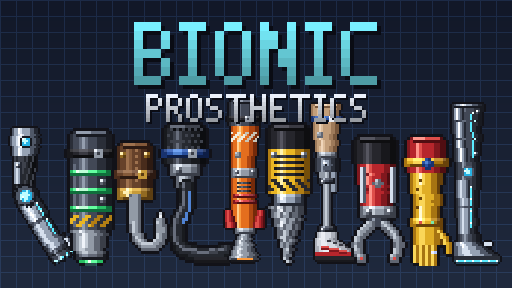

Lost a limb? Not a problem. This mod adds **35 prosthetics** with custom art that snap onto
stumps, resize themselves to fit the wearer, and move within the range of a real limb.
Most of them do something when you activate them.

## Installing

Copy this whole `BionicProsthetics` folder into your People Playground `Mods` folder
(`<Steam>/steamapps/common/People Playground/Mods/`), start the game and turn the mod on.
The prosthetics get their own **Prosthetics** tab in the spawn menu (if the game ever refuses the custom tab, they fall back to **Misc.**).

## How to fit one

1. Take a limb off someone. Slicing works, and so does anything else that separates it at the joint.
2. Drag the prosthetic onto the **stump**:

| Type | Replaces | Touch it to |
|---|---|---|
| Forearm | lower arm + hand | the **upper arm** |
| Full arm | the whole arm | the **chest** |
| Lower leg | lower leg + foot | the **upper leg** |
| Foot | the foot | the **lower leg** (ankle) — sized heel-to-toe to the real foot, sole on the floor |
| Full leg | the whole leg | the **hips** |
| Modular upper arm | the upper arm | the **chest**, then plug any forearm into its elbow |
| Modular thigh | the upper leg | the **hips**, then plug any lower leg into its knee |

It clicks into place with a servo sound. It is sized by measuring the wearer's healthy limb joint to joint
(hip, knee, ankle down to the sole; shoulder, elbow, fingertips), so feet reach the floor exactly like the real foot.
If there is no healthy limb to copy (say both legs are gone), it reads where the joint sits and how long the limb is
off a complete body - the game's Human, or anyone else in the scene - and scales that to this person's size. It is
drawn in the right layer: front arms over the body and legs, back arms behind everything. The wearer's own body won't
collide with it. If you touch the wrong body part of someone it would fit, a hint tells you where it goes.

* **Activate** (F) to use its ability.
* Right-click → **Detach prosthetic** to take it off.
* **Hooks impale:** swing the Pirate Hook or Pirate Arm hard into someone (or something) and the point sinks in and
  sticks, with a spurt of blood - whatever is skewered hangs and swings off the hook. Activate to pull it out; a hard
  enough yank tears it free on its own.
* **Claws and hooks grab people:** activate to clamp onto whatever is at the tip. Arms, legs, heads and loose objects
  are picked before the floor or a wall, so grabbing a person is reliable - and they get a hard squeeze.
* **Modular builds:** a missing arm doesn't have to get a ready-made full arm. Fit a *Modular Upper Arm*, then
  touch any forearm prosthetic (hook, claw, plasma cannon, drill, flashlight, golden hand) to its elbow socket.
  Thighs work the same with peg legs, running blades and pogo springs. You can also assemble the pieces on the
  floor first and then fit the whole thing. Detaching an upper piece keeps whatever is plugged into it.
* **Full arms and full legs have two joints** (shoulder + elbow, hip + knee), so they bend like real limbs.
  Lying loose on the floor the lower half flops freely, but elbows only bend forward and knees only bend back.
* Worn arms move on their own. They hold a relaxed pose (hanging, elbow slightly bent) with a gentle motor, so
  you can grab and pose them freely, and moving one arm never drags the other along. On full arms you can grab
  the forearm itself, too.
* Worn legs are strong enough to carry the wearer and **walk with them**: full legs and modular thighs follow the
  healthy leg half a stride behind, so the steps alternate like real walking. Standing, sitting or crouching, they
  simply match the healthy leg. With no healthy leg to follow they stand straight. A hard hit can buckle the knee,
  and it springs back afterwards.

## The prosthetics

| | Name | Slot | Ability |
|---|---|---|---|
| 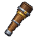 | Pirate Peg Leg | lower leg | — (stiff oak peg, arr) |
| 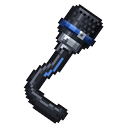 | Carbon Running Blade | lower leg | spring jump |
| 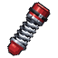 | Pogo Spring Leg | lower leg | squash-and-stretch BOING jump |
| 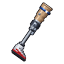 | Medical Prosthetic Leg | full leg | — (working hydraulic knee, fresh sneakers) |
| 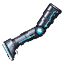 | Cyber Leg MK-II | full leg | hydraulic leap + shockwave; glowing reactor knee joint |
| 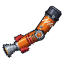 | Rocket Leg | full leg | toggle thruster (with flame, smoke and a light); jointed knee |
| 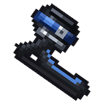 | Carbon Flex Foot | foot | springy hop |
| 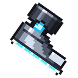 | Cyber Foot | foot | stomp shockwave; glowing sole |
| 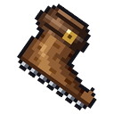 | Pirate Wooden Foot | foot | — (carved oak, iron-nailed sole) |
| 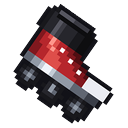 | Roller Skate Foot | foot | rolls nearly frictionless; activate to kick off and glide |
| 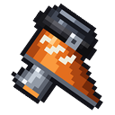 | Rocket Boot | foot | heel thruster: toggle to fly (or flail) |
| 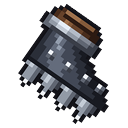 | Spiked Stomper | foot | stomp on someone to impale them; activate to pull free |
| 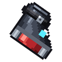 | Magnet Boot | foot | lock onto the floor, walls or ceiling; activate again to release |
| 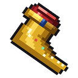 | 24K Golden Foot | foot | glints all the time; activate for a shower of sparkles |
| 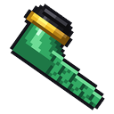 | Scuba Flipper | foot | flap kick |
| 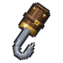 | Pirate Hook | forearm | impales on a hard swing; activate to hook onto people, objects or walls |
| 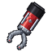 | Hydraulic Claw | forearm | clamp onto people and things (open/closed animation) |
| 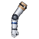 | Medical Prosthetic Arm | full arm | — (jointed elbow, robotic hand) |
| 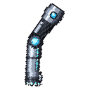 | Cyber Arm MK-II | full arm | powered elbow; rocket punch that sends people flying and can break bones |
| 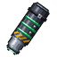 | Plasma Arm Cannon | forearm | fires glowing plasma bolts |
| 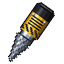 | Drill Arm | forearm | toggle a spinning drill (sparks on metal, blood on people) |
| 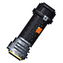 | Flashlight Hand | forearm | toggle a light with a visible beam |
| 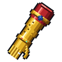 | 24K Golden Hand | forearm | glints all the time; activate for a shower of sparkles |
| 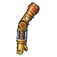 | Steampunk Arm | full arm | vents a scalding blast of steam |
| 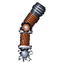 | Tesla Arm | full arm | chain lightning that arcs through up to 4 things |
| 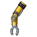 | Loader Claw Arm | full arm | big hydraulic claw: clamp onto people, objects or walls |
| 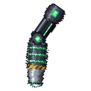 | Heavy Plasma Arm | full arm | fires huge plasma bolts |
| 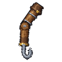 | Pirate Arm | full arm | carved oak arm with a hook: impales on a hard swing, hook on / let go |
| 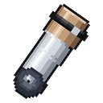 | Modular Upper Arm (Medical / Cyber / Steampunk / Pirate) | upper arm | takes any forearm prosthetic |
| 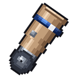 | Modular Thigh (Medical / Cyber / Rocket) | upper leg | takes any lower-leg prosthetic |

## Files

```
mod.json                 mod manifest
Main.cs                  registers the 35 items
ProstheticBehaviour.cs   stump detection, fitting, sizing, servo joints, jointed elbows/knees, modular mounting
Abilities.cs             activation abilities (jump, grab, cannon, punch, drill, rocket, light, bling, steam, lightning)
FX.cs                    asset loading + lightweight particle/shockwave/blast helpers
SpriteData.cs            socket/tip pixel coordinates (generated)
sprites/ thumbs/ fx/     pixel art (full limbs are split into _upper / _lower pieces; _mount = stand-alone upper)
category.png             spawn-menu tab icon
sfx/                     sound effects (CC0 recordings from Kenney and uisfx - see sfx/CREDITS.md)
```

All art and sound is generated by code, so you can tweak and rebuild it. From the repository root:

```
python3 tools/make_art.py   # sprites, thumbnails, fx textures, banner, SpriteData.cs (needs Pillow)
python3 tools/make_sfx.py   # sound effects from the CC0 libraries (needs git, curl, ffmpeg, numpy)
```
